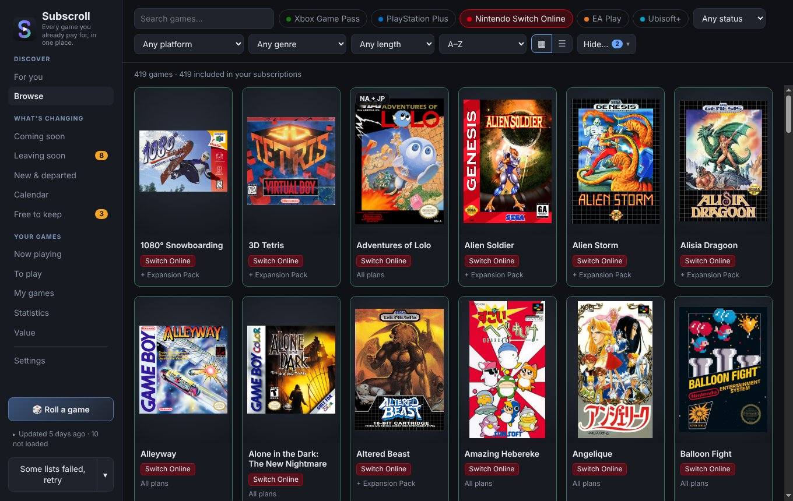
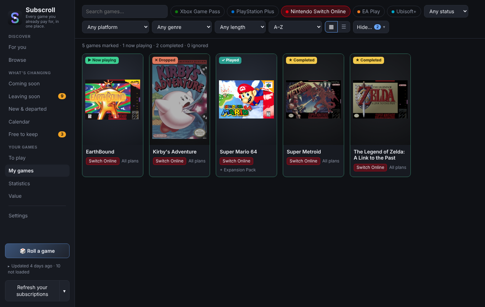
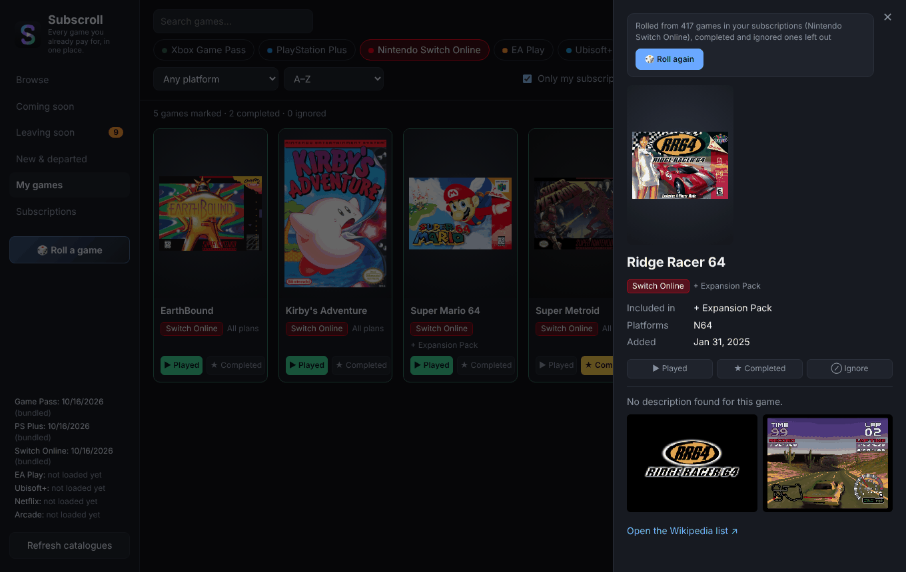
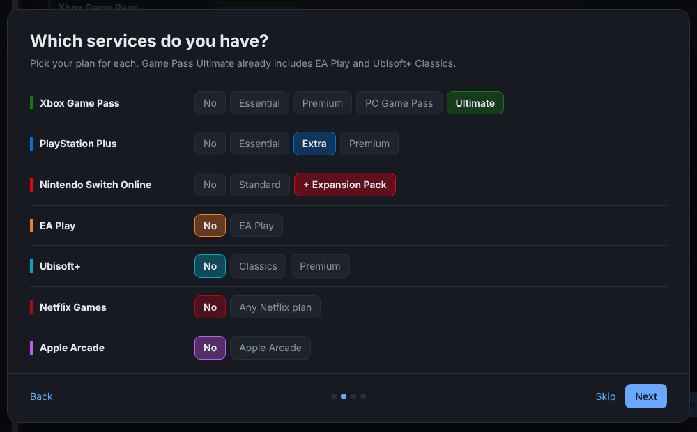
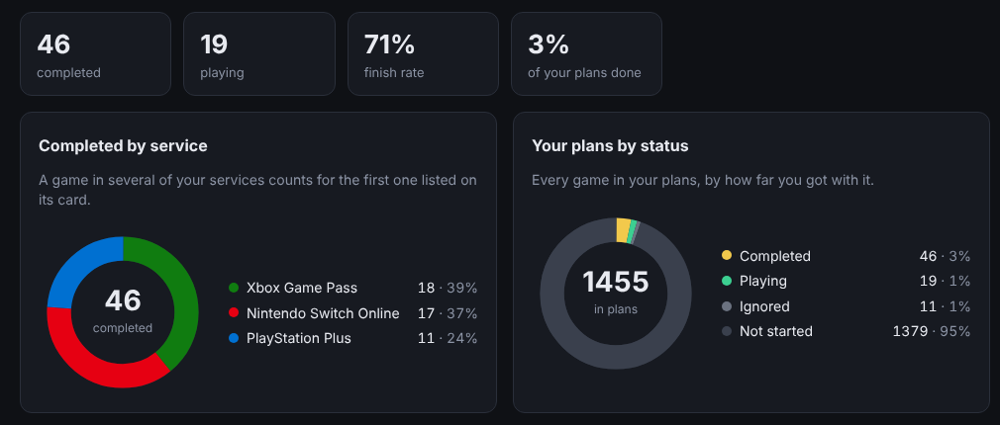
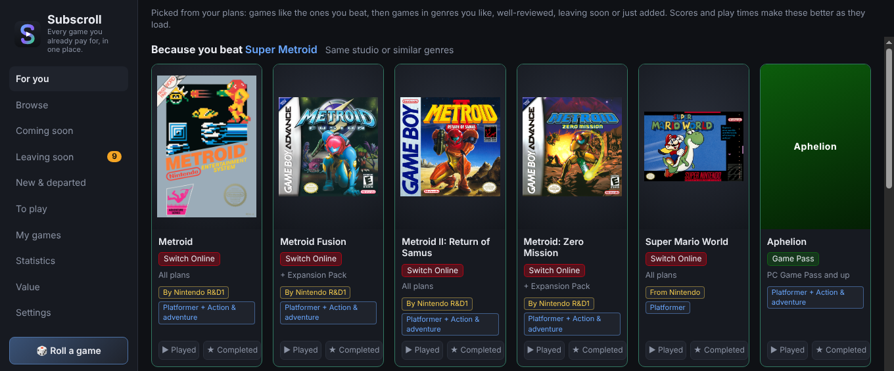
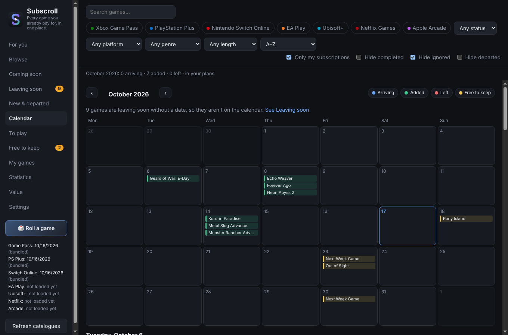

# Subscroll

**Every game you already pay for, in one place.**

| Your played and completed games | Roll a game when you can't decide |
|---|---|
|  |  |

| Welcome setup | Statistics |
|---|---|
|  |  |

A desktop app that shows which games are in Xbox Game Pass, PlayStation Plus, Nintendo Switch Online, EA Play, Ubisoft+, Netflix Games, Apple Arcade, Crunchyroll Game Vault, Humble Choice, Google Play Pass, Amazon Luna, Meta Horizon+ and Antstream Arcade, by tier. You pick the plans you have, mark games as now playing, played, completed or dropped, and see what's leaving soon. Runs on Windows and Linux. Everything you set is saved on your computer, in `%APPDATA%\Subscription Catalogue` on Windows or `~/.config/Subscription Catalogue` on Linux (the app's earlier name).

## Install

### Windows

1. Download the latest `Subscroll-<version>.exe` from [Releases](https://github.com/viruztt/subscroll/releases).
2. Double-click it. There's no installer; the exe is the whole app, so keep it wherever you like.
3. The first time, Windows may say "Windows protected your PC", because the app isn't signed with a paid certificate. Click **More info**, then **Run anyway**.

### Linux

1. Download the latest `Subscroll-<version>.AppImage` from [Releases](https://github.com/viruztt/subscroll/releases).
2. Make it executable: right-click it, **Properties**, tick **Allow executing file as program** (or run `chmod +x Subscroll-*.AppImage`).
3. Double-click it, or run `./Subscroll-<version>.AppImage`. There's nothing to install. If it doesn't open, your system may need FUSE 2 (on Ubuntu 22.04 and later: `sudo apt install libfuse2t64`, or `libfuse2` on older releases).

The tray icon needs a desktop with a system tray. GNOME needs the "AppIndicator and KStatusNotifierItem Support" extension, which Ubuntu includes. The Play buttons open Steam games with your installed Steam (native or Flatpak). The Xbox app button only appears on Windows.

Your plans and marks stay on your computer and carry over when you download a newer version. To move them to another PC, use **Export profile** on the **Backup** tab in Settings.

### Updating

Subscroll updates itself. It checks GitHub for a new version twice a day, downloads it next to the file you're running, and checks it against the checksum GitHub publishes for that file. A box in the sidebar then says the new version is ready: click **Restart to update**, or carry on and it switches over the next time Subscroll starts (Windows startup included). The old file is deleted afterwards. Your plans, marks and settings carry over.

If you keep the release's file name (`Subscroll-0.5.0-….exe`), the new version arrives under its own name. If you've pinned Subscroll to the taskbar or made a shortcut, rename the file to `Subscroll.exe` (or `Subscroll.AppImage`) first: updates then keep that name, so the shortcut keeps working. The folder must be one you can write to, such as Downloads or Documents.

Under **Updates** (Settings › **Background and updates**) you can turn off the automatic download (Subscroll then asks first, with a **Download and install** button), turn off the check altogether, or check straight away. Copies started from source (`npm start`) only show a download link.

## Where the game lists come from

| Service | Source | Leaving dates |
|---|---|---|
| Xbox Game Pass (Essential, Premium, Ultimate, PC) | Microsoft's catalogue service (`catalog.gamepass.com` + `displaycatalog.mp.microsoft.com`), the same lists xbox.com uses | Microsoft's "leaving soon" list flags games, but has no date |
| PlayStation Plus (Essential monthly games, Extra catalogue, Premium classics) | playstation.com's game lists (`/bin/imagic/gameslist`) | Not published in any feed |
| Nintendo Switch Online (+ Expansion Pack) | Wikipedia's [Nintendo Classics](https://en.wikipedia.org/wiki/Nintendo_Classics) article, which lists every game per system with the date it was added (Nintendo has no feed). Box art comes from [libretro-thumbnails](https://github.com/libretro-thumbnails) via the GitHub API | Games almost never leave |
| EA Play, Ubisoft+ (Classics, Premium) | Microsoft's catalogue service, which lists both subscriptions' Xbox and Microsoft Store editions (`eaaccess`, `nakuconsole`/`nakupc`, `ubisoftplus`) | None |
| Netflix Games | Netflix's own developer account on the App Store (Apple's public lookup API). Games published under a partner's account and TV-only cloud games are missing | None |
| Apple Arcade | Wikipedia's [Apple Arcade](https://en.wikipedia.org/wiki/Apple_Arcade) article. Icons, descriptions and screenshots come from Apple's App Store search, a few games a minute in the background (Apple limits it), cached in `catalog/appstore/`. A game whose title differs on the App Store is matched by its developer; one no longer on the App Store has left the service, and gets its Steam cover, or failing that the one from its Wikipedia article | None |
| Crunchyroll Game Vault | Crunchyroll's own developer account on the App Store, like Netflix (Mega Fan and Ultimate Fan memberships) | None |
| Humble Choice | This month's games from the JSON on Humble's page for the month (the membership page says which month is current); they change on the first Tuesday of each month. If Humble changes the page, the app saves it as `catalog/humble-page.html` so the reader can be fixed | None |
| Google Play Pass | Google doesn't publish its list. The community project [playpassBrowser](https://github.com/inkvolcano/playpassBrowser) checks every game's Play Store page for the Play Pass badge each month, per country; the app reads its data and keeps the games offered in your country. Descriptions and screenshots come from the same project | None |
| Amazon Luna (Standard with Prime, Premium) | Amazon doesn't publish its list. [GameScriptions](https://gamescriptions.com/subscription/service/luna_standard) keeps a page per Luna tier with the dates games were added, leave and arrive; the app reads those pages. If they change, it saves them as `catalog/luna-*-page.html` so the reader can be fixed | Yes, from GameScriptions |
| Meta Horizon+ (Games Catalog and monthly games) | Meta's store pages build their lists in the browser, so there's nothing to read there. [Quest+ History](https://questplushistory.com/) records every game added to and removed from the Games Catalog and every month's games since July 2023, and publishes both as JSON; the catalog is every game whose last change was an addition. This month's games are listed until the month ends, the last day to add them to your library. Covers come from [MetaMetadata](https://github.com/threethan/MetaMetadata), which mirrors the Quest store's art daily, with the Steam store as a fallback and Wikipedia after that. The Indie Games Catalog isn't included yet | Monthly games: the end of their month |
| Antstream Arcade | Antstream has no feed. The list comes from the [games page](https://www.antstream.com/gameslist) on antstream.com, which Subscroll opens in a hidden window, pressing "Load More" until every game shows, then reading each game's card (title, system, genre, picture and link). What it read last is kept in the app's `catalog` folder (`antstream-*` files) so the reader can be checked. Box art comes from [libretro-thumbnails](https://github.com/libretro-thumbnails), like Switch Online, with Antstream's own pictures where there is none | None |

Other services can be added under **Add another service** in Settings, with their games added by hand.

If a live source fails, the app falls back to community mirrors on GitHub ([catabox](https://github.com/nanhopper/catabox), [ps-plus-games-list](https://github.com/ppazour/ps-plus-games-list)), and if those fail too it keeps the last list it had. Microsoft's store sometimes refuses part of a burst of requests: the app asks again, takes names and pictures it still lacks from the last list, and refuses a list where more than a tenth of the games would show only a product code. A snapshot ships with the app so it works offline from the first launch.

Game Pass Ultimate includes EA Play and Ubisoft+ Classics, so those games count as in your plans when you have Ultimate. PC Game Pass includes EA Play on PC only, so EA Play's Xbox console games (such as Xbox 360 ones) don't count with it.

A game offered by several services gets one card with a tag for each (dimmed when it's not in your plans), so A Way Out shows once with Game Pass, EA Play and PS Plus. Titles are matched ignoring platform suffixes and edition names; Switch Online and Antstream games are kept apart, since each is a specific old console version (Antstream has Bubble Bobble on Arcade, C64 and Amiga, each its own card), except for regional versions of the same game ("Adventures of Lolo (NA)" and "(JP)"), which share one card marked NA + JP. Marking the game marks it everywhere.

The **Coming soon** page lists announced games with their date: Game Pass from Microsoft's per-plan join dates, Switch Online and Apple Arcade from dates in their Wikipedia lists, Amazon Luna from GameScriptions. PS Plus, EA Play, Ubisoft+ and Netflix don't publish dates in a form the app can read.

**Can you finish it in time?** Games leaving soon say how much you'd need to play each day to beat them before they go, for example "12h to beat, 9 days left: about 1.3h a day", and whether that fits your pace, is tight, or is more than you usually play. Times are How Long To Beat main story times, minus the hours you've already played (your own entry, or Steam's playtime). Your pace comes from your Steam playtime over the last two weeks or the games you've completed in the last three months, whichever is higher (an hour a day until there's either). If you'd rather say it yourself, set how long you play a day, in minutes or hours, in the welcome setup, under **How much you play** in Settings, or at the top of the Leaving soon page; that replaces anything worked out from imports. Sort that page by **What to start first** to see the games with the least time to spare at the top. Xbox doesn't give leaving dates, so for its games Subscroll assumes the next 15th or end of the month, when Game Pass games usually leave, and says so.

**Predictions**, below the games a service says are leaving, lists games that could leave in the next 45 days (for PS Plus, up to the removal day after next, since the next one's departures are usually announced already), worked out from when each joined: most games sign for 12 months (renewed a year at a time), big publishers' games (Ubisoft, Warner Bros., Square Enix...) often 24, Rockstar and 2K games 3 to 6, and the service's own studios' games (Sony's on PS Plus, Microsoft's on Game Pass) usually stay. PS Plus removes games on the third Tuesday of the month and Game Pass on the 15th or the last day. The most likely ones are shown, with games at a later renewal folded away under **Less likely**; hover a date (or open the game) for the reasoning, and each card says how much a day you'd need to play to finish it in time. A Game Pass date less than two weeks off that Xbox hasn't flagged is dropped, as the deal was probably renewed. Only games with a known join date are predicted: Game Pass gives it; for PS Plus it comes from the [PlayStation Blog](https://blog.playstation.com/)'s monthly Game Catalog posts, back to the June 2022 relaunch (games join on the third Tuesday of the month; the first time, Subscroll reads the posts in the background, one every five seconds as the blog asks, which takes a few minutes, then only new ones), with exact days for newer games from the history of [ps-plus-games-list](https://github.com/ppazour/ps-plus-games-list), a daily copy of the PS Plus list kept since July 2026 (downloaded once, then only what's new). PS Plus publishers come from the product ids (EP9000 is Sony's own); for other services the date comes from Subscroll's own refreshes. Sony's "Last Chance to Play" list on the console isn't public, so PS Plus predictions aren't confirmed by it.

**How past predictions did**, under the predictions, keeps score. Subscroll saves each prediction the first day it makes it and, once that day has passed, checks what happened: the game left around the predicted day (within a week before or two weeks after, since a departure is only noticed at the next refresh), left on another day, or was still in the list at a refresh after the day. It shows how many likely and less likely calls were right, broken down by service and rule (12-month deals, big publishers, Rockstar and 2K). A rule whose likely calls have been right less than a quarter of the time, after at least five, is shown as less likely from then on. The record is kept for a bit over a year and goes into profile exports.

**Refresh your subscriptions** at the bottom of the sidebar refreshes the catalogues of the plans you have (all of them if you haven't picked any); its ▾ arrow offers **Refresh all catalogues**. Catalogues also refresh automatically once a day, all of them, including while the window is closed: Subscroll stays in the system tray (right-click the icon to refresh, turn options on or off, or quit) and can start when you log in (with Windows, or through your desktop's autostart on Linux), minimised to the tray. After each refresh it sends a notification when games join a service in your plans or games in your plans start leaving, leaving out games you've completed, dropped or ignored; clicking it opens the right page. These are under **Background** (Settings › **Background and updates**). Every refresh is compared with the previous one, so the "New & departed" page shows what was added in the last 30 days and what left (Wikipedia's Apple Arcade list keeps every game there has ever been, so an Arcade game that neither your country's nor the US App Store has any more counts as having left). Game Pass games show when they joined, from Microsoft's own dates.

The **Calendar** shows a month at a time: games arriving (announced dates), games that joined, games that left, and free games (giveaways, PS Plus monthly games and Free Play Days weekends) starting or on their last day, each in its own colour (click a colour in the key to hide that kind). It follows the same filters as the other pages, so with games outside your subscriptions hidden it's your plans' month. Click a game to open it, or a day to list everything on it below the calendar. Xbox flags games as leaving soon without a date, so those aren't on it; a note links to Leaving soon instead.

Clicking a game shows a short description and a few screenshots. Game Pass gets both from Microsoft's catalogue; PS Plus reads the game's PlayStation Store page; Switch Online games get title screens and gameplay shots from libretro-thumbnails and the opening of the game's Wikipedia article. Looked-up details are cached for 30 days in `details.json`.

The sidebar groups the pages into **Discover** (For you, Browse), **What's changing** (Coming soon, Leaving soon, New & departed, Calendar, Free to keep) and **Your games** (Now playing, To play, Plan ahead, My games, Statistics, Value), with Settings below and its tabs for plans, region and language, appearance, accounts, background and updates, backup, and data sources. The line above the Refresh button says when the oldest catalogue was downloaded; click it for each one's date. Long explanations at the top of a page show their first sentence, and ⓘ opens the rest.

**Now playing** lists the games you've marked ▶ Now playing, the ones leaving soon first, each with how far you are: your hours played (or Steam's) against How Long To Beat's main story, and how many hours are left. **+1h** adds an hour to your hours played without opening the game.

Game cards show your mark (now playing, played, completed, dropped or ignored) as a badge on the cover; hover a card for its buttons. The ▦ / ☰ buttons next to the sort menu switch between covers and a compact list with one game a line. **Ctrl+F** (or **/**) jumps to the search box (on the Value page, to the search in Games you beat).

The toolbar filters by service (with games outside your subscriptions hidden, only your services get a chip), played status, platform, **genre** and **length** (under 5 or 10 hours, 10 to 20, 20 to 40, over 40, by How Long To Beat's main story). Each store names genres differently, so they're mapped onto one list (`renderer/genres.js`); Switch Online games count as Retro. The length filter only shows games that have a time.

Cards show the **Metacritic** score and the **How Long To Beat** main-story time, and the list can be sorted by score or from shortest to longest. Neither site has a public API, so the app uses the search endpoints their own pages call, looks every game up once in the background (games in your plans first, one game at a time per site with a pause in between) and caches each site's answer for a month in `ratings.json` (two weeks for games it couldn't find). Later launches only look up new games and ones whose answer has expired. If a site refuses or fails, the app backs off, stops asking that site after five failures in a row and tries again next launch; the other site carries on, and its answers are kept. If either site changes its search, the numbers stop updating until the app is fixed; everything else keeps working.

**Light or dark**: Subscroll starts dark. Under Settings → **Appearance** pick **Light**, or **Same as Windows** to follow your Windows colour setting (it switches when Windows does).

**Languages**: the app is in English, French, German, Italian, Brazilian Portuguese, Japanese and Korean. It follows your system language until you pick one under Settings → Region and language. Game names, descriptions and service names stay as each store writes them.

The country picker in Settings lists every country (named in the app's language) and sets the Xbox market and PlayStation store together. Where Xbox or PlayStation doesn't sell games in your country (Lithuania has no PlayStation Store, for example), pick a fallback country right under it: Game Pass or PS Plus lists and store prices then come from that country's store, and everything else still uses yours (Netflix and Apple Arcade through your App Store, Google Play Pass where it's offered). Which countries have which store comes from xbox.com/regions, Xbox's PC Game Pass launches and the PlayStation country list (checked October 2026). Switch Online only differs in Japan, which gets its Japan-only games (Wikipedia's "JP" column) instead of the western-only ones.

Store lists use placeholder dates for games without a release date yet (Microsoft's is 9998-12-30); those show no date.

The first time it opens, a short **welcome setup** asks for your country (guessed from your system language), the plans you have, what you like to play (genres, short or long games) and, if you like, how long you play a day, then shows a first set of picks. The **For you** page keeps those recommendations: games from your plans in the genres you like, boosted by good Metacritic scores, leaving soon, just added, recently released and, if you picked a length, How Long To Beat times, with no more than a few from one service. Each card says why it was picked. The setup can be run again from Settings.

Below those picks, **Because you beat…** rows take the games you've marked as completed and find games in your plans like them: by the same developer, from a smaller publisher you've played (big ones like Nintendo or Xbox Game Studios publish too much to mean anything), or sharing the less common genres. Developers and genres come from each service's list where it has them (Xbox, EA Play, Ubisoft+, Apple Arcade, Switch Online publishers); for Switch Online, PS Plus and Netflix games, and for the games you've completed, they're read from the game's Wikipedia article in the background, a game every second or so, cached a month in `wikipedia.json`. The game panel shows the developer and publisher too.

Your **star ratings** steer both. A game you rated 4 or 5 stars gets its own **Because you loved…** row even if you haven't finished it, and rows for your favourites come first. Genres you rate highly rise in the picks (the card says "You rate Puzzle highly"), and genres you rate low sink. A game that's more like one you rated 1 or 2 stars than like anything you enjoyed is left out of the rows. Games you've rated aren't suggested again.

The **To play** list is your wishlist: click ＋ on a game's cover (or **To play** in its details) for anything you want to get to, whether it's out now or still coming. The page groups them into ready to play in your plans, coming soon (with dates), in services you don't have, and ones that have left every service; the sidebar counts the ones you can start now. When a game on the list arrives in your plans (its date comes, or it joins a service you have), you get a "Ready to play" alert. Marking it played or completed takes it off the list, and so does Steam once you've played it there.

At the top of the To play page, **Which plan to get** helps if you rotate subscriptions instead of keeping them all. For the games on your list that your plans don't cover, it ranks the plans you could pick up (or upgrade to) by how many of them each one covers, putting games that are leaving soon first, and names a smaller tier when that covers most of them. It also points out plans you have that nothing on your list needs, or where a lower tier would cover the same games.

**Plan ahead** (under Your games) puts your To play and Now playing games against how long you play a day. At the top, **Your backlog** says how many hours they add up to (How Long To Beat main story, minus what you've played; a game without a time counts as 12 hours), how long that takes at your pace, and the day you'd be done. **Month by month** then plans 30 days at a time: you keep the plans you have and add at most one plan a month, picked so you get the most played. Each month lists what to play, in order: games you've started first, then the ones leaving soonest (a service's date, Game Pass's usual day for a flagged game, or a likely prediction), then the shortest. A game that doesn't fit carries on into the next month (one without a How Long To Beat time is marked as a guess). Games that aren't out yet stay out of the plan and its totals, as dates slip and there's no time to beat yet: **Not out yet** lists them with their arrival dates, and they join the plan once they're out. Each added plan shows its list price, with the total underneath. **Might not make it** lists games that leave before the plan gets to them. Change how long you play a day right there and the plan follows.

Each game on the list that you can't play yet says the **cheapest way** to play it, and its details list the three cheapest: a month (or the shortest payment) of the cheapest plan that has it, buying it at today's store price (sale prices included), or waiting until it joins a plan you already have when it's announced. Plan prices are the list prices on the Value page, so they're only as current as those; a store price shows once the app has looked the game up, which it does for To play games twice a day.

**Free to keep** lists games you can claim for free and keep for good: Epic's weekly free games (from Epic's own store list, with exact end dates and next week's games), plus Steam, GOG and Prime Gaming giveaways (Prime Gaming is now claimed through Amazon Luna) from [GamerPower](https://www.gamerpower.com/)'s public giveaway list. Each one shows when the offer ends and links straight to the claim page; mark it **Claimed** or **Not interested** to tidy it away. The list is checked every few hours, and with alerts on you get a notification when new ones appear and on the last day of any you haven't claimed (turn that off under Settings → Background).

It also lists your plans' own monthly freebies. **Humble Choice** games are listed with the date you need to claim them by. **PS Plus monthly games** are added to your library while you have PS Plus, from the first Tuesday of the month until the first Tuesday of the next: this month's come from PlayStation's own list, and next month's appear under "Coming next" once the PlayStation Blog announces them. **Xbox Free Play Days** (from Xbox Wire's weekly post) let you play a few full games free from Thursday to Sunday; most need any Game Pass plan except PC Game Pass, and some, including timed trials, are open to everyone. Ones that need a plan you don't have are hidden, with a link to show them, and only ones you can play send alerts.

Games can be marked **now playing**, played, completed, **dropped** (started, but you stopped) or ignored (⊘, for games you're not interested in). Cards show two buttons: the first is ▶ Now playing, or shows Played or Dropped when a game has that mark (click it to clear it); a game's details have all of them. The toolbar's **Hide…** menu hides games outside your subscriptions (on once you've picked plans), completed, dropped, ignored (on by default) or departed games, and the button shows how many of those are on; dropped and ignored games stay on the My games page, and the status filter's "Dropped" and "Ignored" options show them too, so you can change their mark.

**Roll a game** picks a random game from the plans you have (from everything if none are set), leaving out games you've completed, dropped or ignored and following the service and platform filters.

Other services can be added in Settings, with their games entered by hand.

The **Value** page compares what the games you beat would cost to buy outright with what you've paid for the subscriptions. For each plan, pick what you pay from a list of today's prices for your country (monthly, 3-month or yearly; checked October 2026, and you can enter your own amount instead) and the month you started. If you stopped and came back, add another period with its own start, end and price, so a gap isn't counted; prices are looked up for the games you've completed (the service's own store first: Microsoft Store for Game Pass, EA Play and Ubisoft+, PlayStation Store for PS Plus; then Steam), at today's full price, and cached for a month in `prices.json`. Tick the games a subscription paid for and untick ones you bought or played some other way. Games you mark as completed yourself start unticked; games marked by an import start ticked unless you own them on Steam or they aren't in your plans. A search box and an All / Ticked / Unticked filter help with a long list. You can also type a price where none was found (Switch Online classics aren't sold anywhere), and optionally count games you played but didn't finish. **Dropped** games always count, for the part of them you played: your hours played over How Long To Beat's main story time (a game you put 5 hours into out of 20 counts for a quarter of its price), or a quarter when either is missing. Their rows say how much, for example "dropped · 25%".

It also works out **cost per hour** from the hours you played each game (the **Hours played** you enter in its details, or your Steam playtime from an hour up), or How Long To Beat main story times where neither is known: what an hour of play cost you through subscriptions (overall and per plan), what it would have cost buying the games, and each game's price over its hours. Games without a time count at the average of the ones with one.

The **Statistics** page shows how far through your plans you are: games completed, how many of those you played through a subscription (the games ticked on the Value page), now playing, played and dropped, your finish rate (completed out of every game you've started, dropped ones included), a pie of completed games by service (a game in several of your services counts for the first one on its card), your plans split by status, progress per service, the genres you finish most, and, the hours of games you've finished (your hours played, or How Long To Beat where you haven't entered any). Completed games that have since left a service still count. Pick a **platform** (Xbox, PC, PlayStation, Switch, mobile, VR) at the top to see the same numbers for just that platform, and **Progress per platform** compares them side by side (the bars count games in your plans; games you've played outside them, bought or marked by an import, are counted next to the bar); a game on several platforms counts for each, and Switch Online's classics count as Switch. Click a slice of a pie, a legend row, a genre, or the completed, completed through a subscription, now playing, played, dropped and Steam numbers at the top to see the games in it.

At the top, **Goals** let you set targets like "beat 2 games a month" or "beat 10 hours of games a week" (your hours played, or How Long To Beat). Each goal shows how far you are this week, month or year, how many periods in a row you've made it, your best streak, and the last twelve periods at a glance. Games count in the period you marked them completed; ones imported as completed from Xbox or PlayStation are dated by when you last played them. Games you'd completed before goals existed have no date: open one and set **Finished** to count it.

**Steam library** (Settings › **Accounts**) reads the games you own on Steam (Steam's Web API, with your profile link or Steam ID and a free API key from [steamcommunity.com/dev/apikey](https://steamcommunity.com/dev/apikey); your profile's Game details must be public). Games you own get an "On Steam" badge and can be filtered with the status filter's "On Steam" option, and games you've played there for 30 minutes or more are marked as played. Each game is marked once, so unmarking it sticks. The library is read again with the daily refresh. Switch Online games aren't matched, since they're old console versions.

**Xbox achievements** and **PlayStation trophies** in Settings work the same way: games you've earned an achievement or trophy in are marked as played, and games at 100% (or with the platinum trophy) as completed, once each, so a mark you change sticks. A game's details show how far you got. Xbox needs a free API key from [OpenXBL](https://xbl.io) (sign in with your Xbox account and create a key on your profile), a free service that reads achievements from Xbox Live. PlayStation needs your NPSSO code: sign in at playstation.com, open [ca.account.sony.com/api/v1/ssocookie](https://ca.account.sony.com/api/v1/ssocookie) and copy the `npsso` value. Treat that code like a password, since it signs in to your PlayStation account; Sony makes it run out after about two months. Both are read again with the daily refresh.

**Sale alerts**: To play games that aren't in any of your plans (in other services, or gone from every service) are checked twice a day on the Microsoft Store, PlayStation Store or Steam. When one goes on sale it gets a "% off" badge with the sale price, and you get a notification (once per sale price; a deeper cut is news again). Turn the alerts off under Settings → Background.

**Your rating and notes**: a game's details have five stars to rate it and a box for your own notes (where you got to, what to try, who recommended it). **Hours played** takes your own play time when Steam doesn't know it or you also played elsewhere; it's used instead of How Long To Beat for cost per hour, goals and leaving-soon deadlines. Rated or noted games get a ★ badge, **Your rating** in the sort menu puts your favourites first, and search finds words in your notes too. Ratings steer the For you page, and ratings and notes are in the profile export.

**Play buttons**: a game's details have buttons to start it. If you own it on Steam (see Steam library above), **▶ Play on Steam** launches it, or **Install with Steam** installs it when Steam says it isn't installed. Games in a PC Game Pass, EA Play or Ubisoft+ list open in the **Xbox app** (at their PC edition, when Xbox lists an older console edition separately, as with Xbox 360 games), and PS Plus games open on the **PlayStation Store**.

**Cloud play**: games you can stream get a ☁ Cloud badge, highlighted when one of your plans lets you stream it, and "Cloud streaming" in the platform filter lists just those. Xbox Cloud Gaming comes from [Gameglass](https://github.com/jackheuberger/gameglass), which reads Microsoft's cloud catalogue every few hours and works out which Game Pass tiers can stream each game (US catalogue; read once a day). PlayStation's own lists say which games PS Plus Premium can stream. A game's details say which plans can stream it.

**GeForce NOW**: GeForce NOW doesn't come with games; it streams copies you own on Steam, Epic, Ubisoft Connect, the Xbox app (PC Game Pass) and other PC stores. Games on its list get a GeForce NOW badge, highlighted when you can stream it with what you have: the game is in your Steam library, or in a plan you have that includes its PC version (PC Game Pass or Ultimate, EA Play, Ubisoft+). Free-to-play games are highlighted too. A game's details list the stores it streams from. The list is NVIDIA's own list of supported games, read once a day.

**Export & import profile** (Settings › **Backup**) saves everything Subscroll keeps about you to one `.json` file: plans, marks and your To play list, your own services and games, settings, Value page costs, your Steam link, free games you claimed or skipped, and when games joined or left each list. Ticking "Include looked-up data" also saves the Metacritic scores, play times, prices, descriptions and covers it has looked up, so another PC doesn't have to look them all up again. **Import profile** on another PC (or after a reinstall) asks first, then replaces your plans, marks and settings and adds the history and looked-up data to what that PC already has. The file includes your Steam, OpenXBL and PlayStation keys if you added them, so keep it private. Backups saved by older versions still import. Catalogues themselves aren't in the file; the app fetches them again.

## Credits

Subscroll reads its data from these services and projects. Thanks to everyone who runs them.

**Official sources**
- Microsoft: the Game Pass catalogue (`catalog.gamepass.com`), Microsoft Store product data (`displaycatalog.mp.microsoft.com`) and [Xbox Wire](https://news.xbox.com/) for Free Play Days.
- Sony: [playstation.com](https://www.playstation.com/)'s PS Plus game lists, PlayStation Store pages and prices, the [PlayStation Blog](https://blog.playstation.com/) (its monthly lineups also say when PS Plus games joined), and the PlayStation trophy service (with your own sign-in).
- Apple: the [App Store](https://www.apple.com/app-store/) lookup and search API, for Netflix Games, Apple Arcade and Crunchyroll Game Vault.
- Valve: the [Steam Web API](https://steamcommunity.com/dev) and Steam store search, for your library, covers and prices.
- [Epic Games Store](https://store.epicgames.com/)'s free games list.
- [Humble Bundle](https://www.humblebundle.com/membership)'s Humble Choice pages.
- [Google Play](https://play.google.com/store/pass/getstarted) store links and images.
- [GitHub](https://github.com/): the releases API and release downloads, to update Subscroll.
- Antstream: the [games page](https://www.antstream.com/gameslist) on antstream.com, including its game pictures.
- NVIDIA: the [GeForce NOW](https://www.nvidia.com/en-gb/geforce-now/games/) list of supported games, for the GeForce NOW badge.

**Community projects and sites**
- [Wikipedia](https://en.wikipedia.org/): the Nintendo Classics and Apple Arcade game lists, game descriptions, developers, genres and covers (text under [CC BY-SA](https://creativecommons.org/licenses/by-sa/4.0/)).
- [libretro-thumbnails](https://github.com/libretro-thumbnails): Switch Online and Antstream Arcade box art, title screens and screenshots.
- [playpassBrowser](https://github.com/inkvolcano/playpassBrowser) by inkvolcano: the Google Play Pass list.
- [GameScriptions](https://gamescriptions.com/): the Amazon Luna lists and dates.
- [Quest+ History](https://questplushistory.com/) by Carlos Santiago: the Meta Horizon+ Games Catalog and monthly games.
- [MetaMetadata](https://github.com/threethan/MetaMetadata) by threethan: Meta Quest store names and cover art for Meta Horizon+ games.
- [Gameglass](https://github.com/jackheuberger/gameglass) by Jack Heuberger: which Xbox games stream with Cloud Gaming.
- [catabox](https://github.com/nanhopper/catabox) by nanhopper: the Game Pass mirror used when Microsoft's service fails.
- [ps-plus-games-list](https://github.com/ppazour/ps-plus-games-list) by ppazour: the PS Plus mirror used when playstation.com fails, and its history for when PS Plus games joined.
- [GamerPower](https://www.gamerpower.com/): Steam, GOG and Prime Gaming giveaways.
- [OpenXBL](https://xbl.io/): Xbox achievements (with your own API key).
- [Metacritic](https://www.metacritic.com/) and [How Long To Beat](https://howlongtobeat.com/): scores and play times.

Subscroll isn't affiliated with or endorsed by any of them. Game names, artwork and trademarks belong to their owners.

## License

The code is under the [MIT License](LICENSE), copyright (c) 2026 Šarūnas Rimša.

The data the app reads belongs to its sources (see Credits) and keeps their terms. The same goes for the offline snapshots bundled in `data/snapshot/`:
- `nso.json` is built from Wikipedia's Nintendo Classics article ([CC BY-SA 4.0](https://creativecommons.org/licenses/by-sa/4.0/)).
- `gamepass.json` and `psplus.json` are copies of Microsoft's and Sony's catalogue lists.

Game names, artwork and trademarks belong to their owners.

## Building from source

`npm install`, then `npm start` runs the app (Windows, macOS or Linux). `npm test` runs the tests, and `npm run dist:win` / `dist:mac` / `dist:linux` builds a package into `dist/`, which git ignores. To add or fix a translation, edit `renderer/locales/<language>.js`: each line maps the English text to the translation, keeping `{placeholders}` as they are, and plurals are `{ one, other }` objects. New text in the code goes through `t()`, `tn()` (plurals) or `tEl()` (text around a link). Development builds are named `Subscroll-<version>-<commit>.exe`. The Linux AppImage builds on Linux (`npm run dist:linux`). `src/linux.js` holds the Linux versions of start at login and the Steam install check. The Mac version builds on GitHub's Macs (`.github/workflows/mac.yml`, run from the Actions tab, and by itself when a release is published): one `.dmg` for Apple silicon and one for Intel, signed ad hoc by `scripts/adhoc-sign.js` because there's no Apple developer certificate.

## Layout

- `src/main.js`: window, IPC, daily refresh. `src/details.js`: descriptions and screenshots. `src/ratings.js`: Metacritic and How Long To Beat. `renderer/regions.js`: countries, their stores and the fallback. `src/backup.js`: profile export and import. `src/providers/playpass.js` and `src/providers/luna.js`: Google Play Pass (playpassBrowser) and Amazon Luna (GameScriptions). `src/providers/horizonplus.js` and `src/providers/antstream.js`: Meta Horizon+ (Quest+ History and MetaMetadata) and Antstream Arcade (antstream.com games page). `src/steam.js`: Steam library import. `src/achievements.js`: Xbox achievements (OpenXBL) and PlayStation trophies. `src/alerts.js`: what the tray notifications say. `src/prices.js`, `renderer/value.js` and `renderer/planprices.js`: the Value page (game prices, paid periods, plan list prices) and sale prices. `src/sales.js`: sale alerts. `src/updates.js` and `src/selfupdate.js`: the new version check, and downloading and switching to it. `renderer/recommend.js`: For you picks and "Because you beat". `renderer/advisor.js`: Which plan to get. `renderer/planner.js`: Plan ahead (backlog forecast and month-by-month plan). `renderer/scorecard.js`: how past predictions did. `renderer/cheapest.js`: the cheapest way to play a game. `src/freegames.js`: Free to keep (Epic store feed and GamerPower). `src/monthly.js`: PS Plus monthly games (playstation.com list, PlayStation Blog) and Xbox Free Play Days (Xbox Wire). `renderer/calendar.js`: the Calendar page. `renderer/goals.js`: goals and streaks. `renderer/deadline.js`: can you finish a leaving game in time, and your playing pace. `renderer/predict.js`, `src/providers/psblog.js` and `src/providers/pshistory.js`: Leaving soon predictions, and when PS Plus games joined (PlayStation Blog lineups, mirror history). `renderer/play.js`: the Play buttons (Steam, Xbox app, PlayStation Store links). `src/cloud.js`: which Xbox games stream (Gameglass). `src/gfn.js`: which games stream on GeForce NOW. `src/wiki.js`: developers, genres and covers from Wikipedia infoboxes. `src/catalog.js`: refresh, fallbacks, history, merging Xbox console/PC duplicates. `renderer/i18n.js` and `renderer/locales/`: translations (the English text is the key; `node scripts/i18n-keys.js --missing` lists what a language still lacks).
- `src/providers/`: one file per service.
- `renderer/`: the UI (plain HTML/CSS/JS). `renderer/unify.js` merges the same game across services; `renderer/stats.js` works out the Statistics page. The logo is `renderer/logo.svg`; `renderer/icon.png` (window) and `build/icon.png` (exe) are 256 and 512 px renders of it.
- `data/`: bundled snapshot used until the first refresh. `npm run snapshot` rebuilds it. `scripts/match-covers.js` rebuilds the offline Switch Online cover map; titles whose box art is named differently go in `data/nintendo-cover-aliases.json`.
